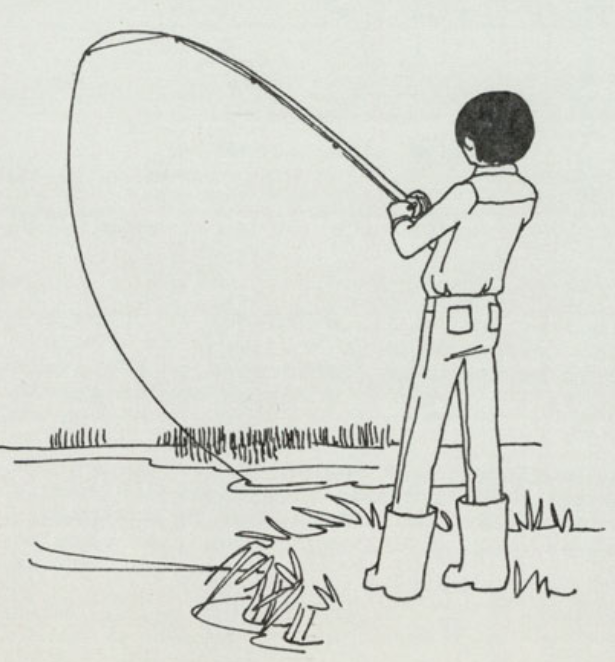
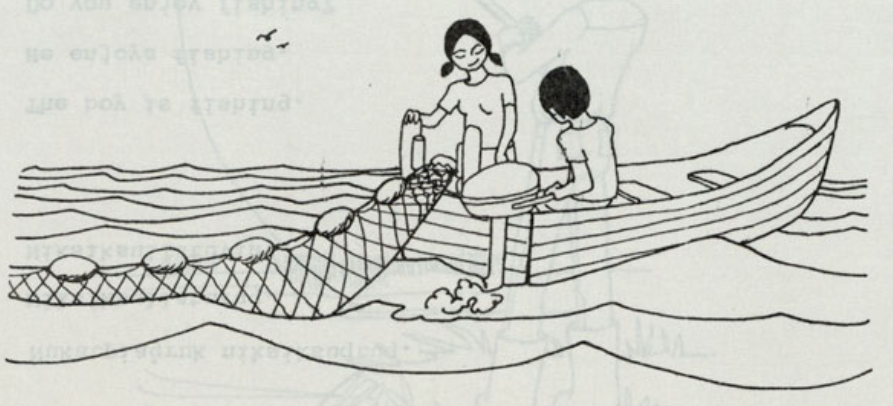

<!-- Reminders: if something isn't loading great, you can use two commands in this order. system("quarto render") and then system("quarto preview") -->

::::: {#two-panel .two-panel}
::: main-panel
<h2>Inupiaq</h2>

```{=html}
<div class="main-content">

<!-- PARAGRAPH 1 -->
<div class="text-image-row">
  
  <div class="text-lines">
    
    <div class="my-hover">
      <span style=”color:lime”> Nukatpiaġruk </span> <span style="color: lime"> niksiksuq</span><span style="color: cyan">tuq</span>.


      <div class="my-hover-text">
        <p><strong> <span style="color: lime"> Nukatpiaġruk </span> <span style="color: lime"> niksiksuq</span>-<span style="color: cyan">tuq</span></strong></p>
        
        <p><strong> <span style="color: lime"> boy.before.puberty </span> <span style="color: lime"> to.fish</span>-<span style="color: cyan">statement.he</span></strong></p>
        
        <p> The word “<span style="color: lime">nukatpiaġruk</span>” means a young boy. This is the doer of our sentence’s action.</p>
        
        <p> This next word is our verb base. “<span style="color: lime">niksIksuq</span>” means to fish, but this verb also needs to tell us who is doing fishing.</p>
        
        <p> To show who is doing the action of our sentence, we need a verb ending to add to our verb base “<span style="color: lime">niksIksuq</span>”. We can use the “<span style="color: cyan">tuq</span>” ending to tell us that “he” is fishing. You can read more about verb ending for statements here. </p>
        
      </div>
    </div>


<!-- PARAGRAPH 2 -->

    <div class="my-hover">
      <span style="color: lime">Niksiksu</span><span style="color: magenta">llatu</span><span style="color: cyan">ruq</span>.

      <div class="my-hover-text">
        <p><strong><span style="color: lime">Niksiksuq</span>-<span style="color: magenta">llatu</span>-<span style="color: cyan">ruq</span></strong></p>

        <p><strong><span style="color: lime">to.fish</span>-<span style="color: magenta">to.enjoy</span>-<span style="color: cyan">statement.he</span></strong></p>  

        <p> This sentence has the same verb base from the previous line, “<span style="color: lime">niksIksuq</span>” which means to fish. </p>

        <p> This time, we are going to add some extra information to the verb. Inupiaq can do this through what is called a “<span style="color: magenta">postbase</span>”, which is always added after the verb base. This postbase, “<span style="color: magenta">llatu</span>”, means “to enjoy”, so when added to our verb base: “<span style="color: lime">niksIksuq</span>” + “<span style="color: magenta">llatu</span>”, it means “to enjoy fishing”. To make this a complete sentence, we still need to add a <span style="color: cyan">verb ending</span>, which tells us who or what is doing the action.  </p>

        <p> Similar to the first line of the story, we can use the “tuq” ending to tell us that “he” enjoys fishing, but when the letter before the ending is a vowel, it changes to “<span style="color: cyan">ruq</span>”. Since “<span style="color: magenta">llatu</span>” ends with the vowel “u”, we use the ending “<span style="color: cyan">ruq</span>” instead of “tuq” to mean “he” is the doer of the action. This chart can be a handy reference to find the correct verb ending for statements.</p>

      </div>
    </div>


<!-- PARAGRAPH 3 -->

    <div class="my-hover">
      <span style="color: lime">Niksik</span><span style="color: magenta">su</span><span style="color: magenta">llatu</span><span style="color: cyan">viñ</span>?

      <div class="my-hover-text">
        <p><strong>Niksik-su-llatu-viñ</strong></p>

        <p>Ending "viñ" is for intransitive, interrogative, second-person singular.</p>
      </div>
    </div>
  </div>
  
</div>

<br><br>
<br><br>

<!--- PARAGRAPH 2 --->
<div class="text-image-row">

  <div class="text-lines">
  
    <div class="my-hover">
      <span style="color: lime">Aġnaġ</span><span style="color: magenta">lu</span> <span style="color: lime">nukatpiaġ</span><span style="color: magenta">lu</span> <span style="color: lime">kuvriq</span><span style="color: cyan">suk</span>.

      <div class="my-hover-text">
        <p><strong>Agnaq-lu nukatpiaq-lu kuvrIq-tuk</strong></p>

        <p>Postbase "lu" means "and". Notice it is marked on both subjects in the sentence.</p>

        <p>Ending "tuk" is for intransitive, indicative, third-person dual marking.</p>

        <p>Notice the strong i in "kuvrIq"? Near the end of the word, it palatalizes the "t" in "tuk" to "s".</p>
      </div>
    </div>
    
    <div class="my-hover">
      Nukatpiaq aquttuq.

      <div class="my-hover-text">
        <p><strong>Nukatpiaq aqut-tuq</strong></p>

        <p>Ending "tuq" is for intransitive, indicative, third-person singular. Note how it is different from "tuk" in the previous story line.</p>
      </div>
    </div>
    
    <div class="my-hover">
      Kuvriqsiḷḷaviñ?

      <div class="my-hover-text">
        <p><strong>Kuvriq-si-ḷḷa-viñ</strong></p>

        <p>Postbase "ḷḷa" means "to be able to".</p>

        <p>Ending "viñ" is for intransitive, interrogative, second-person, singular.</p>
      </div>
    </div>
  </div>
  
</div>


</div>
```
:::

::: {#side-panel .side-panel}
<h2>English</h2>

<p>Let's Read! by Edna Agheak MacLean</p>

<p>The boy is fishing.</p>

<p>He enjoys fishing.</p>

<p>Do you like fishing?</p>

<br><br>

<p>The woman and the young man are setting a net.</p>

<p>The young man is steering the boat.</p>

<p>Can you set a net?</p>
:::

```{=html}
<button class="toggle-button" id="toggle-button" onclick="togglePanel()">

›

</button>
```
:::::

```{=html}
<!-- This is javascript -->
<script>

function togglePanel() {

<!-- find the two panel container and... -->
const container = document.getElementById("two-panel");

<!-- allow for the container to be open or collapsed --> 
container.classList.toggle("collapsed");

<!-- find the button and... -->
const button = document.getElementById("toggle-button");

<!-- change the direction of the arrow if open or collapsed -->
if (container.classList.contains("collapsed")) {
button.textContent = "‹";
} else {
button.textContent = "›";
}
}

</script>
```
